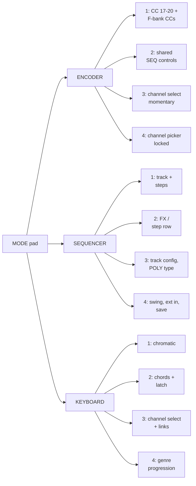

# Panel map

Two maps: the **logical** one (pad IDs, which is what the firmware counts) and the **mode**
one (how the families and variants nest).

Physical placement is your build's business — this page describes what is wired to what.

## Pad → LED map

48 pads, 42 LEDs. The strip is addressed by pad index; six pads have no LED.

| Pads | Function | LED |
|---|---|---|
| 0–15 | Step pads | 0–15 |
| 16–24 | Control buttons (PREV, NEXT, M1–M3, M1–M4) | 16–24 |
| 25–31 | White keys | 25–31 |
| 32–34 | Mode buttons (ENC / SEQ / KEY) | 32–34 |
| 35–36 | Transport | 35–36 |
| 37–41 | Black keys | 37–41 |
| 42–47 | — | none |

The keyboard is **not** in pad order: it is chromatic across the two rows, so the LED
sequence is

```
25, 37, 26, 38, 27, 28, 39, 29, 40, 30, 41, 31
C   C#  D   D#  E   F   F#  G   G#  A   A#  B
```

That ordering is what makes a scale light up as a shape rather than as two rows.

## Encoder and display

| Element | Detail |
|---|---|
| Encoders 1–8 | Quadrature, 4 counts per detent, no wrap on any dial |
| OLED | SSD1306 128×64, I²C, paged write (~4 ms per page at 400 kHz) |
| Header | y 0–15: mode + 21-character message |
| Main area | y 16–63: 4×2 encoder grid, then the control legend (ENCMODE 1/2/4 omit the legend) |
| LEDs | 42× WS2812, idle brightness 64/255, breathing 64→200 |

## Mode / variant map



Variant 3 is momentary in every family (hold the mode pad, release to restore). `ENC 4` is
the only locked variant. Everything else is sticky until you change it.

## Where the state lives

| State | Lifetime |
|---|---|
| Patterns, steps, per-step attributes, per-step GNR8 modifiers, SKANK locks | RAM — lost on power cycle, by design |
| Track settings, generator knobs, page settings, per-channel mode memory | EEPROM, saved with `SEQ 4 + REC` |
| CC knob positions per channel | EEPROM, saved with `ENC 4 + REC` |
| LEAD per-contour cache | Session RAM |
| Progression in `KEY 4` | Rebuilt from the knobs, never stored |

See [Concepts](concepts.md) for why the split falls where it does, and
[Architecture](architecture.md) for the module that owns each piece.
