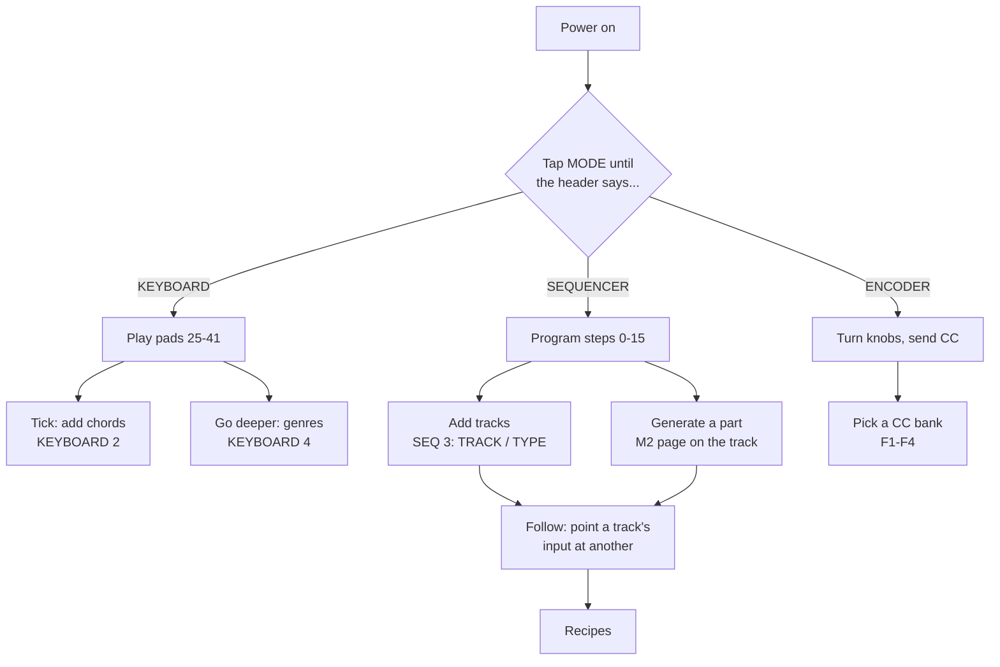

# Start here

Five minutes, no manual. The instrument has **three mode families** on one pad, and the
header on the OLED always tells you which one you are in (`ENCODER 1`, `SEQUENCER 3`,
`KEYBOARD 2`).

## Path A — play it (2 minutes)

1. Tap **MODE** until the header reads `KEYBOARD 1`.
2. Play the pads. White keys are the lower row of the keyboard zone, black keys the upper.
   Only in-scale pads light; out-of-scale pads stay dark.
3. **ENC2 = SCALE**, **ENC3 = KEY**, **ENC1 = OCT**. A scale change announces only its
   mood (`Scale Happy`); the value line shows which scale is selected.
4. Tap the lit mode pad again for `KEYBOARD 2` — chords. Pads now play triads, and
   **ENC8 = LATCH** holds them after you lift your fingers.

More: [Keyboard modes](modes/keymode.md).

## Path B — sequence a beat (5 minutes)

1. Tap **MODE** until the header reads `SEQUENCER 1`.
2. **Hold** the **SEQ** pad to reach `SEQUENCER 3`, the track-config screen (letting go
   returns you to `SEQUENCER 1`).
3. **ENC6 = TRACK** selects the track, **ENC7 = TYPE** its type — pick `DRUM`.
4. Back to `SEQUENCER 1`. On a DRUM track, **hold M1** to get the orange part-select
   overlay, tap a step pad to choose the drum part, then tap steps to place it.
5. **PLAY** starts the internal clock.

A DRUM track also has a preset page: **M2** opens 18 authored styles with live FILL and
MOT. [DRUM preset styles](generators/drum-styles.md).

## Path C — knobs as a controller (1 minute)

1. Tap **MODE** to `ENCODER 1`.
2. **ENC1–4** send CC 17–20 on the encoder channel; **ENC5–8** send the armed F-bank.
3. **F1–F4** choose the CC block, **M3** switches the page group (CC 1–16 or CC 21–36).
4. A DAW feeding CC 1–36 back moves the matching knobs.

More: [Encoder mode](modes/encmode.md).

## Path D — let it generate (10 minutes)

1. Build a chord progression in `KEYBOARD 4` (18 genre grammars) or just play chords in
   `KEYBOARD 2`.
2. On a MONO track with **TYPE = BASS**, press **M2** → the GNR8 page. **M3** generates a
   bassline; **M3 hold** undoes it.
3. Point a second MONO track (**TYPE = ARP** or **LEAD**) at the bass track: `SEQUENCER 3`,
   **ENC5 = INCH** to the bass track's channel, **ENC3 = FOLLOW** on.
4. That is the chain — bass, HARM, chords, LEAD. Worked end to end in
   [recipe: bass → HARM → chords → LEAD](recipes/harmony-chain.md).

## Nothing makes sound?

Work down this list before changing anything:

| Check | Where |
|---|---|
| Is the track muted? (M2 on the track's channel) | [SEQ overview](modes/seqmode.md) |
| Is the sequence's channel the one your DAW listens to? | [MIDI I/O](reference/midi-io.md) |
| Is the step actually active, and inside the pattern length? | [SEQ overview](modes/seqmode.md) |
| Is `SEQ 4 → SRC` set to the port the notes arrive on? | [Timing](modes/timing.md) |
| Is the keyboard channel the one you expect (default ch2)? | [MIDI I/O](reference/midi-io.md) |

The full symptom → cause → fix table is in the [FAQ](faq.md).
